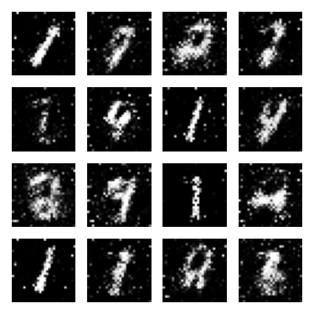
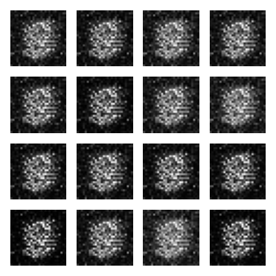
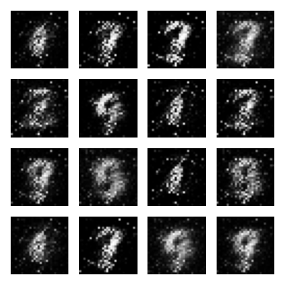
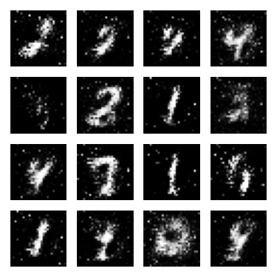

# GAN sencilla para aprender (MNIST)

Implementación minimalista y documentada de una **Red Generativa Antagónica (GAN)** que aprende a generar dígitos escritos a mano, como los del dataset [MNIST](http://yann.lecun.com/exdb/mnist/), a partir de ruido aleatorio.

Este es un proyecto de ejemplo, hecho para **aprender**, no para obtener el mejor resultado posible. El código es corto, está comentado y puede leerse de principio a fin en una sola sesión.



---

## Contenido

- [Qué es una GAN](#qué-es-una-gan)
- [Características](#características)
- [Estructura del proyecto](#estructura-del-proyecto)
- [Inicio rápido](#inicio-rápido)
- [Resultados](#resultados)
- [Orden recomendado para leer el código](#orden-recomendado-para-leer-el-código)
- [Conceptos clave](#conceptos-clave)
- [Ideas para continuar](#ideas-para-continuar)

---

## Qué es una GAN

Dos redes neuronales compiten entre sí:

| Red | Rol | Objetivo |
|-----|-----|----------|
| **Generador** | Falsificador | Crear imágenes falsas cada vez más convincentes a partir de ruido. |
| **Discriminador** | Detector | Distinguir las imágenes reales de las falsas. |

Al competir, ambas mejoran. Al final, el Generador queda entrenado para crear imágenes nuevas parecidas a las reales.

```
 Ruido aleatorio ──► [ Generador ] ──► Imagen falsa ──┐
                                                       ├──► [ Discriminador ] ──► ¿Real o falsa?
 Dataset MNIST ───────────────────► Imagen real ──────┘
```

---

## Características

- Genera dígitos del 0 al 9 con el estilo de MNIST.
- Funciona en CPU (más lento, pero no se nececita GPU).
- Descarga el dataset de forma automática.
- Guarda una imagen de ejemplo después de cada época para observar la evolución del modelo.
- Toda la configuración está centralizada en `config.py`.
- Código pensado para leerse y entenderse.

---

## Estructura del proyecto

```
Recreacion-GAN-sencilla/
├── resultados/        # Imágenes generadas durante el entrenamiento
├── config.py          # Hiperparámetros y valores configurables
├── dataset.py         # Descarga y preparación de MNIST
├── models.py          # Generador y Discriminador
├── utils.py           # Utilidades (guardado de imágenes de ejemplo)
├── train.py           # Bucle de entrenamiento (archivo principal)
├── requirements.txt   # Dependencias
└── README.md
```

---

## Inicio rápido

### 1. Clonar el repositorio

```bash
git clone https://github.com/sanickg/Recreacion-GAN-sencilla.git
cd Recreacion-GAN-sencilla
```

### 2. Crear un entorno virtual (opcional)

```bash
python -m venv venv
source venv/bin/activate      # En Windows: venv\Scripts\activate
```

### 3. Instalar las dependencias

```bash
pip install -r requirements.txt
```

### 4. Entrenar

```bash
python train.py
```

La primera vez se descargará MNIST automáticamente (pesa unos cuantos MB).

### Tiempo de entrenamiento

En CPU el entrenamiento puede tardar varios minutos o más, según el número de épocas definido en `config.py` (`NUM_EPOCHS`). MNIST es un dataset pequeño, pero una GAN sigue siendo un modelo pesado de entrenar sin GPU.

---

## Resultados

Después de cada **época** (una pasada completa por el dataset) se guarda una imagen en la carpeta `resultados/` con 16 ejemplos generados, desde `epoca_001.png` hasta `epoca_030.png`. A continuación se muestra la comparacion entre distintas etapas del entrenamiento:

| Época 1 | Época 10 | Época 20 | Época 30 |
|:-------:|:--------:|:--------:|:--------:|
|  |  |  |  |

Se aprecia cómo el Generador pasa de producir ruido casi sin estructura a formar trazos que se parecen a dígitos reales.

---

## Orden recomendado para leer el código

1. **[`config.py`](config.py)**: todos los valores configurables en un solo lugar. Conviene leerlo primero para tener contexto de los tamaños y parámetros que se usan más adelante.
2. **[`dataset.py`](dataset.py)**: cómo se descargan y preparan las imágenes reales que se le muestran a la red.
3. **[`models.py`](models.py)**: las dos redes, `Generador` y `Discriminador`. Aquí se define la arquitectura del proyecto.
4. **[`utils.py`](utils.py)**: una función pequeña que guarda imágenes de ejemplo como PNG con matplotlib, para visualizar el progreso.
5. **[`train.py`](train.py)**: el archivo que integra todo; aquí ocurre el entrenamiento. Es el más extenso.

---

## Conceptos clave

| Concepto | Explicación |
|----------|-------------|
| **Tensor** | Forma en que PyTorch representa números (similar a un array de NumPy, pero optimizado para redes neuronales). |
| **Ruido / vector latente** | Lista de números aleatorios que se entrega al Generador como punto de partida. Cambiar el ruido cambia la imagen resultante. |
| **Época (epoch)** | Una pasada completa por todo el dataset. |
| **Batch (lote)** | Grupo pequeño de imágenes que se procesan juntas en lugar de una por una, lo que es más rápido y estable. |
| **Loss (pérdida)** | Número que mide qué tan mal lo hace la red. Entrenar consiste en reducirlo gradualmente. |
| **Backward / gradientes** | Mecanismo con el que PyTorch calcula en qué dirección ajustar cada parámetro interno de la red para que la pérdida disminuya. |
| **Optimizador (Adam)** | Componente que modifica esos parámetros internos usando los gradientes calculados. |

---

## Ideas para continuar

- Aumentar `NUM_EPOCHS` y observar cómo cambia la calidad de las imágenes.
- Modificar el tamaño del vector de ruido o de las capas en `models.py`.
- Probar otro dataset, como Fashion-MNIST.
- Entrenar con GPU y comparar los tiempos.
- Explorar variantes como **DCGAN** (con convoluciones) o **cGAN** (para elegir qué dígito generar).

---

## Autor

Desarrollado por Alfonso López Martínez [@sanickg](https://github.com/sanickg).
